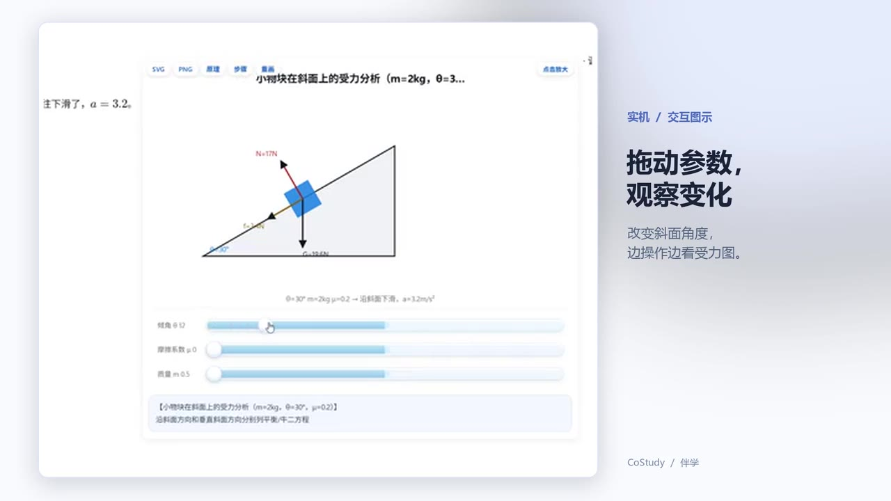

<p align="center">
  
</p>

# CoStudy 伴学

**你的专属学习搭子。** CoStudy 把 Cos（角色扮演）和 Study（学习）结合起来。你可以先定制一位合得来的学习搭子，再让它根据你的回答找出卡点、分步讲解，并用同类题确认你是否真的学会了。

[下载 Windows 桌面版](https://github.com/moranelysia/qiany-CoStudy-xhlandtg/releases/latest/download/CoStudy-Desktop-Setup.exe) · [试学一道题](https://moranelysia.github.io/qiany-CoStudy-xhlandtg/trial.html) · [进入网页版](https://moranelysia.github.io/qiany-CoStudy-xhlandtg/app.html) · [产品官网](https://moranelysia.github.io/qiany-CoStudy-xhlandtg/)

[](https://moranelysia.github.io/qiany-CoStudy-xhlandtg/#capabilities)

## 从哪里开始

| 入口 | 适合什么场景 | 开始条件 |
| --- | --- | --- |
| [Windows 桌面版](https://github.com/moranelysia/qiany-CoStudy-xhlandtg/releases/latest) | 完整学习流程、交互作图、实验演示、学习报告与本地工作区 | Windows 10/11。自由问答需连接模型 |
| [网页版](https://moranelysia.github.io/qiany-CoStudy-xhlandtg/app.html) | 自定义角色、自由问答、发图片或学习资料 | 现代浏览器。自由问答需配置允许浏览器访问的模型接口 |
| [试学一道题](https://moranelysia.github.io/qiany-CoStudy-xhlandtg/trial.html) | 用约 90 秒走一遍答题、订正、复测和查看报告 | 打开即可体验，样例无需登录或 API Key |

## 产品能力

### 定制学习搭子

从角色工坊选择模板、手动调整，或让 AI 根据描述起草角色。你可以设定角色名字、对你的称呼、语气、开场白及 12 个性格维度。AI 起草需要连接模型，并支持预览后再保存。桌面版支持通过 `chara_card_v2` JSON 导入和导出角色卡。

角色卡决定搭子怎么说话，教学设置决定怎么教。比如，你可以选一位语气活泼的同桌，同时开启「先诊断再教」和引导提问，让它先问你配方法卡在哪一步，再给提示。

### 从一道题走到下一次复习

桌面版把一节课分成七个阶段：

**开场 → 目标确认 → 学情探测 → 知识点拆解 → 逐点教学 → 阶段检验 → 收尾**

在「伴学」中设定科目和目标，直接提问或沿着学习计划推进。桌面版会记录会话进度、知识点掌握度与错步。「学习报告」可导出为可浏览、打印的 HTML，汇总本节课进展、检验结果和待复习内容。

### 按需要打开插件

| 插件 | 能力 |
| --- | --- |
| 数学作图 | 画函数或几何图形，部分图示可在对话中交互查看 |
| 实验演示 | 绘制电路、斜面受力、光路等学习图示。可用「画一个伏安法测电阻的电路图」试用 |
| 代码执行 | 在工作模式中确认后运行 JavaScript，用于核对计算和算法结果 |
| 英语练习 | 出题、纠正语法、朗读句子 |
| 教法开关 | 苏格拉底式提问、先诊断再教、主动提复习 |

桌面版运行本地 MCP 能力服务。聊天模式以只读工具为主，涉及运行代码或写工作区的操作使用工作模式并按界面提示确认。

## 安装与使用

### Windows 桌面版

1. 下载并运行 [CoStudy-Desktop-Setup.exe](https://github.com/moranelysia/qiany-CoStudy-xhlandtg/releases/latest/download/CoStudy-Desktop-Setup.exe)。
2. 从桌面或开始菜单打开「伴学」。在「伴学 → 模型设置」填入模型服务的 `Base URL`、模型 ID 和 API Key，再执行「测试连接」。
3. 到「角色工坊」选一个角色，然后在「伴学」中设定学习目标。可以从「我会解一元二次方程，但不明白配方法为什么要补同一个数」开始。
4. 学完后打开「学习报告」回顾进度。升级前先退出应用，安装到原目录即可继续使用原有数据。

默认安装目录为 `%LOCALAPPDATA%\Programs\CoStudy`。如需迁移或备份，请先查看[数据位置与发布指南](documentation/development.md#数据位置)。

### 网页版与附件

进入网页版「伴学」，打开「模型设置」并测试连接。接口需要兼容 `POST /chat/completions`，并允许网页版所在来源通过浏览器跨域访问。`Base URL` 应填写服务商提供的地址，模型 ID 以该服务实际提供的名称为准。

点击输入框旁的「附件」可预选文件，再单独发送附件或附在问题上一起发。支持 JPG、PNG、WebP、PDF、TXT、Markdown、CSV 和 JSON。每条消息最多 4 个附件，每个文件最多 8 MB，单个纯文本文件最多 64 KB，合计最多 12 MB。图片和 PDF 需要所选模型接口支持相应输入。发送失败会保留文字和已选文件，已发附件可在本浏览器的历史对话中下载。

桌面版提供完整的七阶段教学、复习计划、正式学习报告、交互作图、代码执行和工作区能力。

## 数据与隐私

- 桌面版在本地保存角色卡、会话和学习记录。网页版将状态保存在浏览器存储中，并用 IndexedDB 存附件。更换浏览器或清理站点数据后，旧数据无法从该站点恢复。
- 模型调用会把相关对话和附件发送给所配置的模型服务，调用费用取决于该服务。网页版 API Key 保存在此浏览器中，使用公共设备时请留意。
- 提交 Issue 时请提供版本、复现步骤和脱敏后的报错。请先移除 API Key、私密学习记录和附件。

## 从源码运行

桌面开发以 Windows 为主。需要 Node.js 22.12+ 和 pnpm。在 PowerShell 中运行：

```powershell
git clone https://github.com/moranelysia/qiany-CoStudy-xhlandtg.git
cd qiany-CoStudy-xhlandtg
pnpm install --frozen-lockfile
pnpm exec install-electron
pnpm run dev
```

常用检查：

```powershell
pnpm run typecheck
pnpm run build
.\run.cmd --smoke
```

如果没有安装 pnpm，可运行 `npm install --global pnpm@12`。`.\dev.cmd dev` 与 `pnpm run dev` 等效，`.\run.cmd` 启动前一次构建。网页预览、MCP 自检、Windows 打包与 GitHub Pages 发布步骤见[开发维护指南](documentation/development.md)。

## 仓库导航

| 目录 | 内容 |
| --- | --- |
| [`src/main/`](src/main/) | Electron 主进程、模型请求、学习状态与报告、角色卡和 MCP 客户端 |
| [`src/preload/`](src/preload/) | 桌面 UI 与主进程通信的预加载接口 |
| [`src/renderer/`](src/renderer/) | 桌面与网页版共用的界面、聊天渲染和交互 |
| [`src/shared/`](src/shared/) | 学习进度与附件等共享类型 |
| [`scripts/`](scripts/) | 本地 MCP 服务、桌面自检和 Windows 安装包脚本 |
| [`docs/`](docs/) | GitHub Pages 发布目录，含产品首页、试学、网页适配层及构建产物 |
| [`templates/`](templates/) · [`resources/`](resources/) | 角色模板和桌面图标 |
| [`prototypes/`](prototypes/) · [`documentation/archive/`](documentation/archive/) | 历史 UI 原型、参赛材料与开发记录 |

项目使用 Electron、electron-vite、TypeScript 与原生 HTML/CSS，公式和交互图形分别使用 KaTeX 与 JSXGraph。

[版本发布记录](https://github.com/moranelysia/qiany-CoStudy-xhlandtg/releases) · [报告问题或提交建议](https://github.com/moranelysia/qiany-CoStudy-xhlandtg/issues/new)。仓库目前尚未发布独立的许可证文本。
